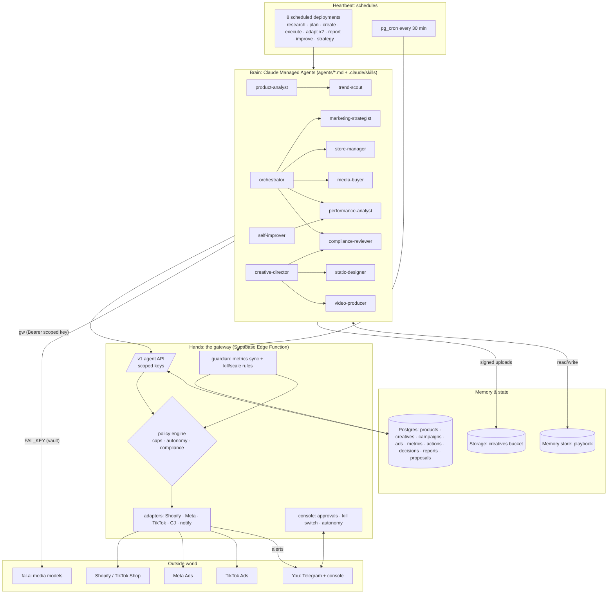

# 01 · Architecture

## Five layers

| Layer | What | Where |
|---|---|---|
| **Brain** | 12 agents (3 leads with specialist rosters) + 28 skills. Judgment: research, planning, copy, creative, review, analysis, improvement | `agents/`, `.claude/skills/` |
| **Heartbeat** | Scheduled deployments run the loops; pg_cron runs the guardian; the guardian can wake loops early (winner found, creative fatigue) | `deployments/`, `supabase/sql/schedule_guardian.sql` |
| **Hands** | The gateway: the only path to the database and to platforms. Enforces policy in code. Dry-run adapters for everything | `supabase/functions/` |
| **Memory** | Postgres "blackboard" for state; Storage for media; Managed Agents memory store for learned knowledge | `supabase/migrations/`, `memory_stores/`, `playbook/` |
| **Eyes** | Console (approvals, caps, kill switch, proposals), Telegram/webhook notifications, daily reports | `_shared/app/console.ts`, `performance-reporting` skill |

## Key design decisions

**Blackboard, not chat.** Loops coordinate only through state (product lifecycle, briefs, creative status,
action queue). Any loop can fail, be skipped or be rerun without breaking the others. Every handoff is
inspectable in the database.

**Intent queue for side effects.** Agents submit *intents* (`POST /v1/actions`). Policy returns
`auto` (executed now), `approval` (queued; you approve on your phone; the gateway executes later, with no agent
session waiting), or `reject` (with reasons the agent must address). Risk-reducing actions (pause,
unpublish) are always allowed, even with the kill switch on.

**Separation of duties.**
- Agents never hold Shopify or ad-platform tokens; the gateway does.
- Keys are scoped per loop. Research sessions read the open web, and are therefore exposed to prompt
  injection, so their key has no `actions` scope: they can't request spend.
- Creatives become `approved` only through the compliance endpoint; creators can't approve their own work.
- Guardrails, autonomy and caps are writable only by a human (console/admin key).
- The self-improver proposes changes to prompts and skills; a human merges them.

**Defense in depth on spend.**
1. Platform caps you set once (Meta account spending limit, TikTok account budget, fal prepaid credits with auto-top-up off)
2. Gateway policy (per-ad-set cap, total committed daily budget cap, +30% step limit, tests/day, compliance required)
3. Guardian spend guard (trips the kill switch and pauses everything above 115% of the cap)
4. Per-run dollar budgets on every Managed Agents deployment (LLM spend)

**Swappable everything.** Media models live in a registry (`media-pipeline/models.json` or the `model_registry`
setting). Platform adapters implement one interface. Rules and weights are settings. Agents and skills are files.

## Agent topology

Managed Agents allows one level of delegation, so there are three coordinators with rosters:

| Coordinator | Model | Roster | Loops |
|---|---|---|---|
| orchestrator | Opus 5.5 | marketing-strategist, store-manager, media-buyer, compliance-reviewer, performance-analyst, self | PLAN, EXECUTE, STRATEGY |
| product-analyst | Sonnet 5.5 | trend-scout (Haiku 5.5), self | RESEARCH |
| creative-director | Opus 5.5 | static-designer, video-producer, compliance-reviewer, self | CREATE |
| self-improver | Opus 5.5 | performance-analyst, self | IMPROVE |
| media-buyer (direct) | Sonnet 5.5 | none | ADAPT |
| performance-analyst (direct) | Sonnet 5.5 | none | REPORT |

Expensive models plan and judge; cheap models read. Workflows (parallel fan-out) are enabled for the
coordinators that handle many items (research sources, creative batches), and disabled for the self-improver.

## Environments and credentials

| Environment | Network | Vault contents | Used by |
|---|---|---|---|
| research | unrestricted (open web) | `GATEWAY_KEY` (read, research, report) | RESEARCH |
| creative | limited: Supabase, fal, fonts + package managers | `GATEWAY_KEY` (read, creative, report), `FAL_KEY` | CREATE |
| ops | limited: Supabase only | `GATEWAY_KEY` (read, research, creative, actions, report) | PLAN, EXECUTE, ADAPT, REPORT, STRATEGY |
| improve | limited: Supabase, fal docs, ad-policy sites | `GATEWAY_KEY` (read, improve, report, research) | IMPROVE |

Vault credentials are `environment_variable` secrets. The sandbox sees only a placeholder, substituted at egress
and only for the credential's allowed host. Platform tokens (Shopify, Meta, TikTok, CJ) live in Supabase
secrets, used only by the gateway.

## Local mode

Everything also runs on your machine. `npm run dev:gateway` serves the same gateway with an in-memory database
and dry-run adapters, and Claude Code picks up the same skills plus the generated `.claude/agents`. This is how
you develop, test prompt changes and run loops by hand before (or instead of) cloud deployment.
