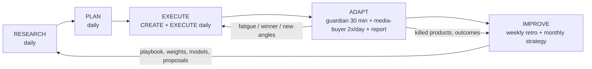
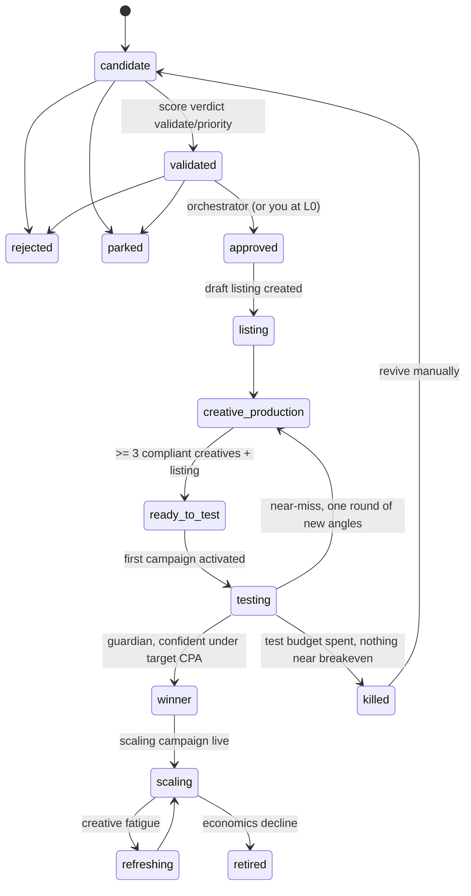

# 02 · Operating loops: research → plan → execute → adapt → improve

## The cycle

| Phase | What happens | Output |
|---|---|---|
| **Research** | Scouts scan rotating sources; the analyst triages against hard gates, then validates: proof, teardown, supplier, economics, big-box check, angles; scores with the rubric | `validated` products with evidence and media in storage |
| **Plan** | The orchestrator approves products into open test slots, commissions the marketing plan (avatars, angles, offer, copy) and opens the first creative brief | `approved` products, briefs |
| **Execute** | CREATE: the creative director plans a diverse batch; producers make videos and statics; compliance gates every asset. EXECUTE: draft listing → publish → launch paused test → activate (policy/approval) | approved creatives, live listings, live tests |
| **Adapt** | The guardian syncs metrics and applies kill/scale/refresh rules every 30 minutes. The media-buyer handles judgment twice a day. The REPORT loop sends the P&L to your phone | kills, scales, refresh briefs, winners, daily report |
| **Improve** | Weekly retrospective → playbook updates, score-weight calibration, model scouting, eval-backed proposals. Monthly strategy and autonomy recommendation | better priors for every loop |

## Product lifecycle (enforced by the gateway)

Creative lifecycle: `brief → in_production → in_review → approved | rejected → live → fatigued → retired`.
Only the compliance endpoint can move a creative to `approved`.

## Cadences (America/New_York by default; edit `deployments/*.md`)

| Loop | When | Agent | Budget cap per run |
|---|---|---|---|
| RESEARCH | 05:17 daily | product-analyst | $4 |
| PLAN | 06:47 daily | orchestrator | $4 |
| CREATE | 08:23 daily + event wakeups | creative-director | $10 (LLM; media capped by fal prepaid) |
| EXECUTE | 11:13 daily | orchestrator | $4 |
| ADAPT | 09:37 and 18:37 | media-buyer | $2.50 |
| REPORT | 20:53 daily | performance-analyst | $1.50 |
| IMPROVE | Sundays 07:41 | self-improver | $12 |
| STRATEGY | 1st of month 09:29 | orchestrator | $8 |
| GUARDIAN | every 30 min | code (no LLM) | ~$0 |

Minutes are deliberately off the hour (schedules on :00 get jittered more and collide). Each run opens and
closes an `agent_runs` record, so every loop's cost and outcome are visible.

## Event-driven wakeups

With `ANTHROPIC_API_KEY` and `LOOP_DEPLOYMENTS_JSON` set on the gateway, the guardian runs a deployment
immediately when:
- a product is declared a **winner** → CREATE (iterate the winner while it's hot)
- a scaling ad shows **fatigue** → CREATE (refresh before CPA climbs)
- a test needs **new angles** → CREATE

## Cadence modes (cost dials)

| Mode | Research | Create | Adapt | Models | Machine cost (est.) |
|---|---|---|---|---|---|
| **Lean** (pre-winner) | 3x/week | 3x/week, 3 creatives | 1x/day | Sonnet for coordinators | ~$150-250/mo |
| **Standard** | daily | daily, ~5 creatives | 2x/day | as configured | ~$450-750/mo |
| **Scale** (winners live) | daily | daily, 8-12 creatives | 2-3x/day | as configured | ~$900-1,500/mo |

Switch modes by editing deployment schedules and budgets (and models in `agents/*.md`), then `npm run agents:apply`.
See `03-costs-and-roi.md` for the arithmetic.
